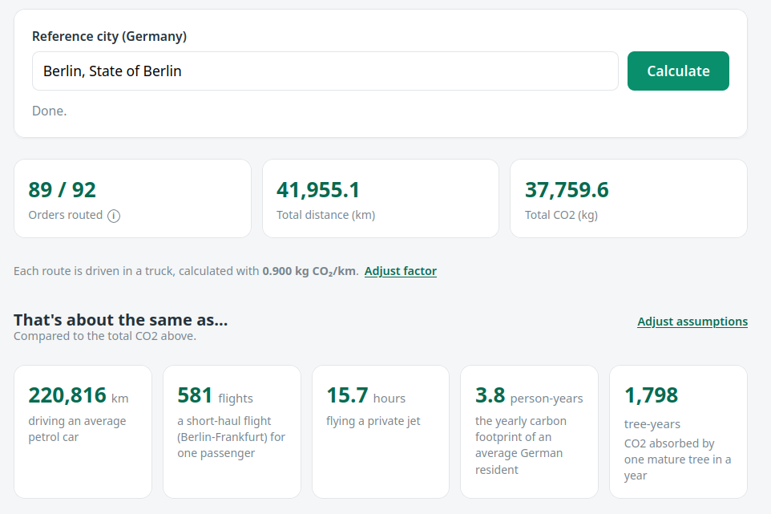
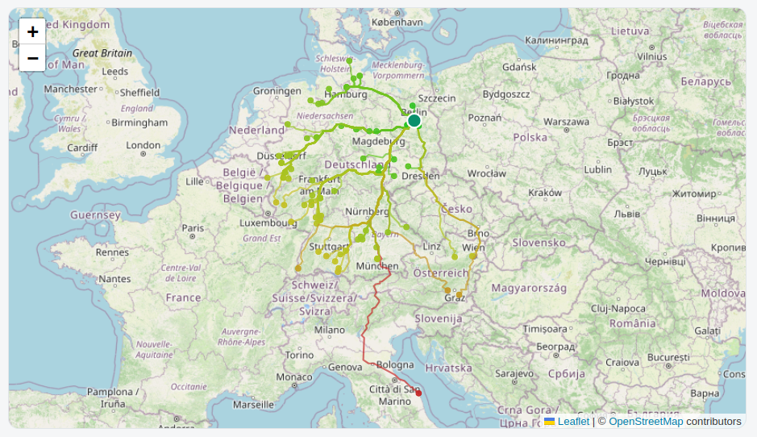

# Vinted CO2 Emissions

Estimate the **CO₂ emissions** of your Vinted orders. Every order is routed by
road from the **seller's city** to a reference city you choose, and the driven
distance is converted to truck CO₂ emissions.

## Screenshots

Results, relatable comparisons and the adjustable emission factor:



All routes drawn on a map, colored by their CO₂ output:



## How it works

1. **Fetch orders** — all orders are read from `GET /api/v2/my_orders`
   (the total is discovered first, then requested in one page).
2. **Resolve seller location** — each order's conversation
   (`GET /api/v2/conversations/{id}`) provides the seller city.
3. **Geocode** — seller cities and the reference city are geocoded with
   [Nominatim](https://nominatim.openstreetmap.org/) (OpenStreetMap).
4. **Route** — the road distance is computed with the
   [OSRM](https://project-osrm.org/) demo server, using the car profile.
5. **Emissions** — `CO₂ = distance_km × truck_factor`
   (default `0.9 kg CO₂/km`, adjustable).

## Web UI

```bash
python3 app.py
# open http://127.0.0.1:5000
```

## Command line

```bash
python3 pipeline.py "Berlin, DE"      # or coordinates: "52.52,13.405"
```

## Setup

```bash
pip install -r requirements.txt
cp config.local.example.json config.local.json
```

The `access_token_web` cookie can be copied from your browser's DevTools
(Application → Cookies) while logged in. It expires after a few hours; refresh
it when a run reports `401 UNAUTHORIZED`. You can also set the `VINTED_COOKIE`
environment variable instead of the file.

## Docker

Build the image:

```bash
docker build -t vinted-co2 .
```

Run it, passing your Vinted cookie:

```bash
docker run --rm -p 5000:5000 \
  -e VINTED_COOKIE="access_token_web=..." \
  -v "$PWD/data:/app/data" -v "$PWD/cache:/app/cache" \
  vinted-co2
```

Then open http://127.0.0.1:5000. The `-v` mounts are optional but keep the
generated results (`data/`) and the geocode/route caches (`cache/`) between
runs. The German cities dataset is already baked into the image at build time.

## Notes and limitations

- **Not all orders can be calculated.** An order is skipped when the seller's
  location is unavailable or when no road route to the reference city exists.
- Only **city-level** seller locations are used (no street addresses).
- Only **German cities** are currently supported (for the reference city and
  the city search).
